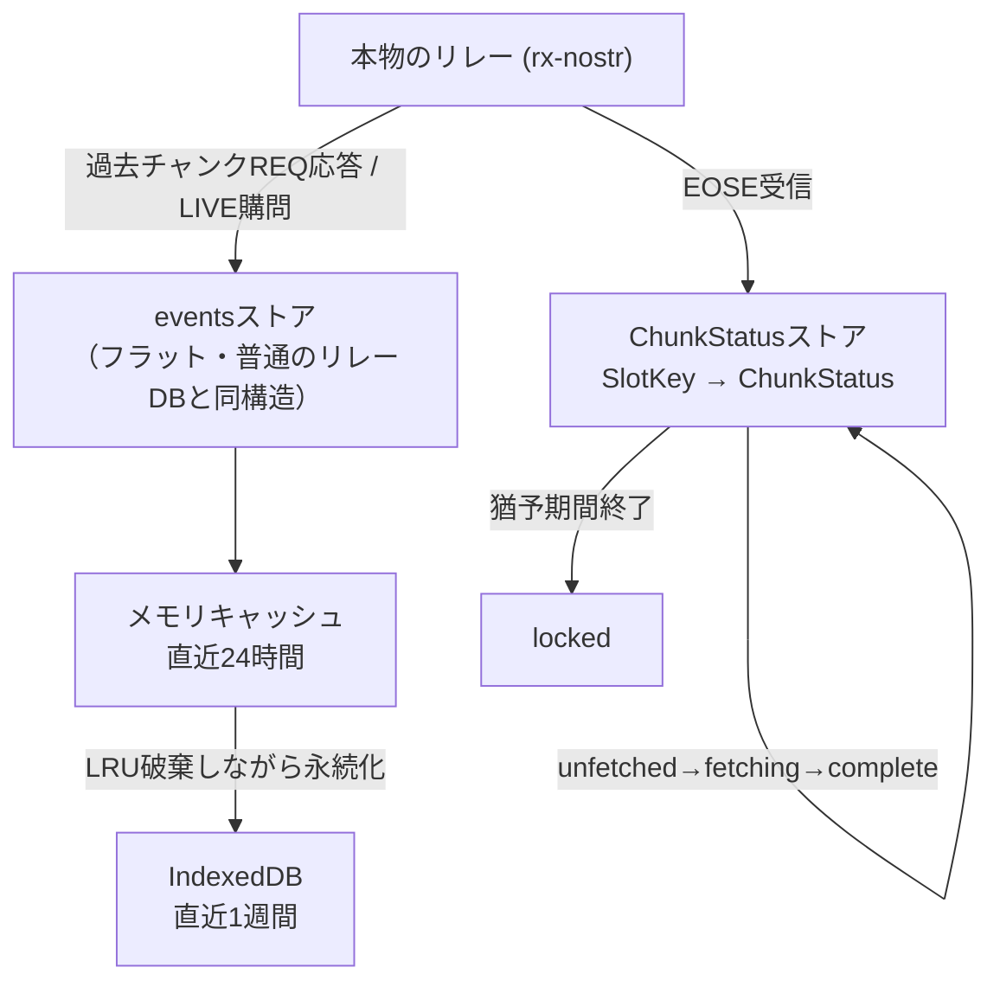
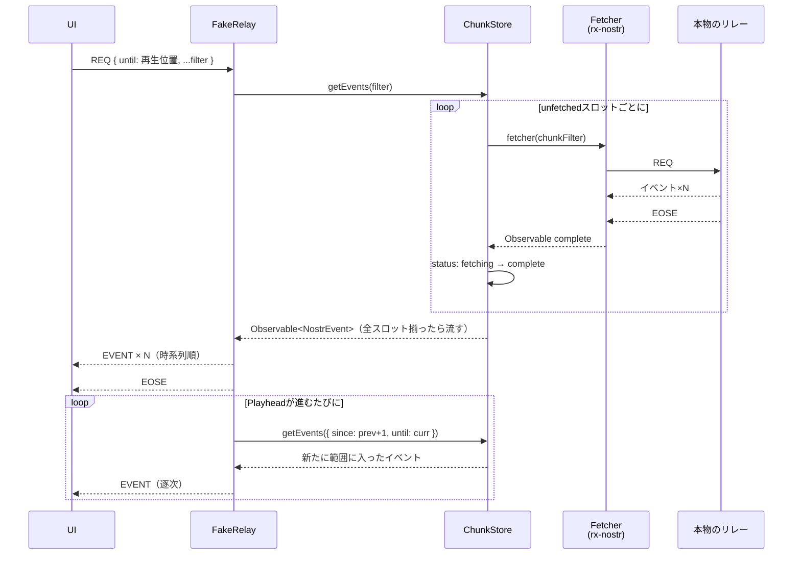

# Nostr タイムライン再生型クライアント 要件書

## 1. 基本コンセプト

- タイムラインを**配信の追っかけ再生**のように操作できる
- 取得・表示の単位は**件数ではなく時間**による
- 画面全体が**YouTubeライブのコメント欄**のようなタイムライン表示域になる
- **右端が常に現在時刻に固定**された時間軸でタイムラインを操作する。動画画面は存在しない

## 2. 画面構成

```
┌─────────────────────────────────────────┐
│ ⚡ NostrPlayer    [追従中]  1.5x  🔊   │
├─────────────────────────────────────────┤
│                                         │
│  ┌─────────────────────────────────┐   │
│  │ 08:14:55  npub1abc...           │   │
│  │ ほげほげほげ                     │   │
│  └─────────────────────────────────┘   │
│                                         │
│  ┌─────────────────────────────────┐   │
│  │ 08:15:02  npub1def...           │   │
│  │ ふがふがふがふが  ◀ 再生ヘッド  │   │
│  │ ▶▶▶▶▶▶▶▶▶▶ 読み上げ中...       │   │
│  └─────────────────────────────────┘   │
│                                         │
│  ┌─────────────────────────────────┐   │
│  │ 08:15:10  npub1ghi...           │   │
│  │ ぴよぴよぴよ                    │   │
│  └─────────────────────────────────┘   │
│                                         │
├─────────────────────────────────────────┤
│ 08:00  08:30  ●09:07  09:30  [現在:10:00] │
│               ▲再生位置                │
│ [⏪] [⏸▶] [⏩] [1.5x▼] [🔊] [● 追従]  │
├─────────────────────────────────────────┤
│ [🙂] なにかコメントする...        [投稿] │
│ ⚙️ 投稿時刻: [再生位置 / 現在時刻]      │
└─────────────────────────────────────────┘
```

## 3. 再生操作

| 操作 | 動作 |
| ---- | ---- |
| **開始時刻指定** | 過去の任意の日時を指定して、その時点から再生開始 |
| **追っかけ再生** | 現在時刻（LIVE）まで自動で追いかける。追いつくとリアルタイム表示になる |
| **一時停止** | 自動スクロール・音声を停止。ユーザは自由に過去をスクロールして読める |
| **倍速再生** | 1.0x / 1.2x / 1.5x / 2.0x。自動スクロール速度と音声読み上げ速度が連動する |
| **シーク（時間軸ドラッグ）** | 時間軸を左右にドラッグして表示範囲を移動。再生位置はドラッグに追従して動く。シークバー上の任意の時刻をクリックすると再生位置がその時刻にジャンプ |
| **ズーム** | ピンチ操作またはスクロールホイールで時間軸をズームイン・アウト |
| **⏪ / ⏩** | 再生ヘッドを -1分 / +1分 移動。⏩は現在時刻を超える場合、現在時刻に固定 |
| **[● 追従]** | 非LIVE時はグレーの●。クリックでLIVEへジャンプし追従開始。LIVE中は●が緑でdisabled（グレーアウト） |

### 倍速選択

[1.5x▼] はドロップダウン。1.0 / 1.2 / 1.5 / 2.0 から選択。

## 4. シークUI・時間スケール

### 4.1 時間軸の設計

シークバーは**時間軸**であり、**右端は常に現在時刻に固定**される。現在時刻が更新され続けることで、軸全体が左に伸び続ける。

- **右端**：常に現在時刻に固定。時間の経過とともに軸が左に伸びていく
- **再生位置**：時間軸上のマーカー。時間軸をドラッグすると再生位置もそれに追従して動く。任意の時刻をクリックすると再生位置がその時刻にジャンプ
- **ズーム**：ピンチ操作またはスクロールホイールで時間軸をズームイン・アウト。右端（現在時刻）を基準にズームする

### 4.2 ズーム

固定のズームレベルは持たず、連続的にズームイン・アウトできる。

| ズーム状態 | 1目盛りの幅の例 | 用途 |
| ---------- | -------------- | ---- |
| 最大ズームイン | 数分 | 特定の投稿を精密にシーク |
| 中間 | 1時間〜数時間 | 通常のLIVE追っかけ |
| 中間 | 1日 | 1日分のTLを概観 |
| 中間 | 1週間 | 週単位で傾向を見る |
| 最大ズームアウト | 数ヶ月〜1年 | 遠過去へのナビゲーション |

ズームレベルは §9.6 で保存・復元される（数値：ピクセルあたりの秒数）。

### 4.3 LIVE判定

再生位置が右端（現在時刻）と一致している場合にLIVE。時間軸をドラッグして再生位置が現在時刻から離れた時点で自動的に非LIVEに切り替わる。再生位置が現在時刻に追いついた時点でLIVEに自動復帰する。

LIVEモードでは再生位置が右端（現在時刻）に張り付いたまま、時間の経過とともに軸が左に伸び続ける。

### 4.4 具体例

**LIVE（中間ズーム）**

```
08:00  08:30  09:00  09:30  [10:07] ← 右端=現在時刻
  |      |      |      |      |
──┼──────┼──────┼──────┼──────┤
                       ●
                   再生位置=現在時刻 → LIVE
                   （現在時刻が進むにつれ軸が左に伸びる）
```

**過去再生（ズームアウト）**

```
2月    3月    4月    5月    6月    [現在:6月8日] 
 |      |      |      |      |      |
─┼──────┼──────┼──────┼──────┼──────┤
               ●
           再生位置=4月15日 → 非LIVE
```

**時間軸をドラッグしてシーク**

```
ドラッグ前（再生位置=09:00）：
08:00  08:30  09:00  09:30  [現在:10:07]
                ●

左にドラッグ（過去方向を表示）→ 再生位置も追従：
06:00  07:00  07:30  08:00  [現在:10:07]
         ●

シークバー上の08:30をクリック → 再生位置がジャンプ：
06:00  07:00  08:00  09:00  [現在:10:07]
               ●08:30
```

### 4.5 遠過去へのアクセス

- **日付ピッカー**で直接ジャンプ → 再生位置がその日時に移動。右端は常に現在時刻のまま
- **ズームアウト**して遠い過去を概観し、目的の日時付近をクリックまたはドラッグ → ズームインして精度を上げる

## 5. 音声読み上げ（TTS）

### 5.1 基本動作

- テキストを音声で読み上げながらタイムラインを進める
- **音声の現在位置＝テキストの再生ヘッド**
- 読み上げ中の投稿にはインジケータ表示

### 5.2 音声ON時の挙動

| 操作 | 音声動作 |
| ---- | -------- |
| 再生開始 | 先頭から順にキューに入れて読み上げ |
| 倍速 | TTS速度も連動（1.2x、1.5x、2.0x） |
| 追っかけ中 | 新着投稿をキューに自動追加 |
| 一時停止 | 音声停止。再開で続きから |
| 手動スクロール（シーク） | その投稿の先頭から読み上げ再開 |
| 音声OFF | 通常のテキストスクロール再生に戻る |

### 5.3 オプション設定

- **声の割り振り**：npubのハッシュで異なる声を割り当て、誰が話しているか判別しやすくする
- **読み上げ対象**：本文のみ / リプライ先も読む / 絵文字・メンションは無視
- **バックグラウンド再生**：ウィンドウ非アクティブ時も音声は続行（Podcast感）

### 5.4 バックグラウンド再生の制約

Web Speech API はブラウザのバックグラウンドタブではスロットリング・停止される制限がある。Tauri はネイティブアプリであるため直接のタブ制限は受けないが、プラットフォームごとに制約が異なる。

| プラットフォーム | バックグラウンド音声 | 備考 |
|-----------------|---------------------|------|
| **Windows/macOS/Linux** | △ 条件付きで可能 | Tauriウィンドウ最小化時、webviewのスロットリングが発生する可能性がある。必要に応じてOSのTTSエンジンを直接呼ぶネイティブプラグインを検討 |
| **Android** | ✕ Web Speech APIでは不可 | Foreground Service が必要。Tauriネイティブプラグインでの対応が必須（§10 注意点参照） |

> **初期スコープ**: バックグラウンド再生はデスクトップ版のフォアグラウンド動作を優先して実装する。Android版のバックグラウンド音声再生は将来的な拡張として別途検討する。

## 6. 投稿（kind1）

- 常時下部に入力欄を表示。**YouTubeライブのコメント欄にコメントするような感じ**でサクッと投稿できる
- リプライは対象投稿を選択してリプライモードに切り替え

### 6.1 投稿時刻の基準（設定で切り替え）

| 設定 | 動作 |
| ---- | ---- |
| **現在時刻にしたがう**（デフォルト） | いつでも投稿した瞬間の現在時刻が `created_at` になる。過去再生中でも「今」の投稿として流れる |
| **再生位置にもとづく** | 再生ヘッドの位置の時刻が `created_at` になる。過去のタイムラインを見ているとき、その時刻に「当時の投稿」として挿入される感じになる |

> **注意**: 「再生位置にもとづく」モードでは、`created_at` に過去の時刻を設定する。Nostrプロトコル上 `created_at` は投稿者が自由に設定可能だが、一部のリレーは現在時刻と大きく離れた `created_at` のイベントを拒否する（NIP-01: `invalid: event creation date is too far off from the current time`）。数時間〜1日程度は多くのリレーで受け入れられるが、1年前等の遠い過去は拒否される可能性が高い。リレーからの拒否時はユーザにフィードバックする。

### 6.2 投稿設定UIイメージ

```
┌─────────────────────────────────────────┐
│ ⚙️ 設定                                 │
├─────────────────────────────────────────┤
│  [投稿]                                 │
│  ┌─────────────────────────────────┐   │
│  │ 投稿時刻の基準                  │   │
│  │                                 │   │
│  │ ○ 現在時刻にしたがう            │   │
│  │    いつでも「今」の投稿として    │   │
│  │    公開される                   │   │
│  │                                 │   │
│  │ ● 再生位置にもとづく            │   │
│  │    再生ヘッドの時刻で投稿する。  │   │
│  │    過去のタイムラインに対して    │   │
│  │    当時のコメントを残せる        │   │
│  └─────────────────────────────────┘   │
│                                         │
│  [音声]                                 │
│  ┌─────────────────────────────────┐   │
│  │ 読み上げ速度: 1.5x              │   │
│  │ バックグラウンド再生: ON        │   │
│  │ npubごとに異なる声: ON          │   │
│  └─────────────────────────────────┘   │
└─────────────────────────────────────────┘
```

## 7. 利用シナリオ

| シナリオ | 状況 |
| -------- | ---- |
| **A. LIVE追っかけ** | 今現在のTLを見たい。再生ヘッド＝現在時刻、時間軸が自動でスライドし続ける。音声ONにすれば新着を読み上げてくれる |
| **B. 数時間前から追っかけ** | 3時間前のTLを指定して再生開始。1.5xで追っかけ再生。現在時刻に追いつくまで自動で進む。追いついたらLIVEモードに移行 |
| **C. 昨日のTLを1日分再生** | 日付ピッカーで「昨日の00:00」を指定。時間軸がその位置にスライド。再生開始。音声ONで「昨日のTLを聴く」 |
| **D. 1年前の特定日を振り返る** | ズームアウトして遠い過去を概観。日付ピッカーで2025/05/30にジャンプ。ズームインして精度を上げる。一時停止しながら自由に読み漁る |
| **E. 音声バックグラウンド（Podcastモード）** | 画面を見ずにタイムラインを聴く。倍速でダイジェスト再生。新着が入れば自動でキューに追加。通勤中・作業中に「Nostrを聴く」 |
| **F. 一時停止して過去を読む** | 再生中に気になる投稿を発見。一時停止 → 自由にスクロールして過去を遡る。未来の投稿はまだ表示されない（時間軸で区切られる）。読み終わったら再生再開 |

## 8. フォロー・フィルタ条件

### 8.1 取得対象ユーザの決定

タイムラインに表示するイベントの対象ユーザは、ログインユーザ（`@konemono/nostr-login` を使用）のフォローリストに基づいて決定する。

#### 取得フロー

1. **ログインユーザのリレーリスト取得**: ログインユーザの **kind:10002**（NIP-65 Relay List Metadata）をデフォルトリレーから取得し、ユーザが利用するリレーの一覧を得る
2. **フォローリスト取得**: 取得したリレーリストのリレーに対して、ログインユーザの **kind:3**（Contact List）を取得する
3. **対象ユーザ抽出**: kind:3 の `tags` 配列から `p` タグを抽出し、フォロー先の pubkey 一覧を得る
4. **TL取得**: 得られた pubkey 一覧を `authors` フィルタに指定して、kind:1 のイベントを取得する

```
ログインユーザ (npub)
    ↓
kind:10002 取得 → リレーリスト [wss://relay-a, wss://relay-b, ...]
    ↓
kind:3 取得 → tags: [["p", pubkey1], ["p", pubkey2], ...]
    ↓
authors: [pubkey1, pubkey2, ...] で kind:1 を REQ
```

### 8.2 リレー選択

- kind:10002 のリレーリストを **デフォルトリレー** として rx-nostr に設定する
- kind:1 の取得・購問はこのデフォルトリレーに対して行う
- kind:10002 が存在しない場合は、アプリ内蔵のフォールバックリレーリストを使用する

## 9. データ取得・キャッシュ

### 9.1 10分チャンク方式

- タイムラインを**10分単位の時間チャンク**に分割して管理
- 各チャンクは `since`/`until` で範囲指定し、1回のREQで取得
- `since`/`until` は **epoch からの unix 秒（整数）** を使用
- 範囲は `since <= ts <= until`（`until` = 次の `since` - 1）とし、NIP-01の両端inclusive仕様に準拠。イベントの重複なし
- キャッシュキーは `kind + スロット開始の unix 秒`（rx-nostr の `uniq()` でリレー跨ぎの重複排除を行うため、relay はキーに含まない）
- スロット開始 unix 秒は `Math.floor(created_at / 600) * 600` で算出（600秒＝10分）

```
チャンク例（epoch unix 秒、until は次の since - 1）：
since=1748768400, until=1748768999 | since=1748769000, until=1748769599 | ... (2025-06-01 09:00〜09:30)
since=1748770200, until=1748770799 | since=1748770800, until=1748771399 | ... (2025-06-01 09:30〜10:00)

日付跨ぎ例:
since=1748821800, until=1748822399 (2025-06-01 23:50〜23:59:59) → since=1748822400, until=1748822999 (2025-06-02 00:00〜00:09:59)
```

> **補足**: スロットキーは文字列（"HH:MM"）ではなく epoch unix 秒（整数）を採用。日付跨ぎを自然に扱い、`timeSlot(created_at)` で一意にスロットが決定される。NIP-01では `since <= created_at <= until` の両端inclusive仕様のため、`until` は次スロット開始の1秒前とすることでチャンク間のイベント重複を防ぐ。

### 9.2 過去再生時の取得

- 指定時刻の10分チャンクをREQ
- 1回のREQで返ってくる件数がmax_limitに到達した場合（イベントが多い場合）、最後に取得したイベントの時刻を新しいuntilとして**同じ10分範囲内で追加REQを行う**
- これは内部的な取得処理の分割であり、**UIに「ページ」概念は出てこない**
- 全イベント取得完了後、その時刻からシームレスに再生開始

### 9.3 LIVE追っかけ時のリアルタイム取得

- 購問型REQ（CLOSEしない）で常時受信
- イベントは**届いた瞬間に随時表示される**
- 受信したイベントはフラットなイベントストアに直接格納する
- 表示はチャンク確定を待たない

### 9.4 リアルタイムデータの格納とスロット状態管理

リアルタイム購問で流れてくるイベントは、**フラットなイベントストアに直接格納する**。チャンク（10分スロット）の概念はフェッチ状態の管理のみに使う。イベント自体をスロットごとに分けて保管はしない。

スロットの状態遷移は created_at の時刻を基準にして管理する。

```
購問中（常時受信中）
    ↓
イベント到着
    ↓
eventsストアに格納（フラット）
    ↓ （スロット状態の管理）
created_at を見て 09:07:15 なら → [09:00〜09:10] スロットはまだ受信中
created_at を見て 09:12:30 なら → [09:10〜09:20] スロットはまだ受信中
    ↓
現在時刻が 09:10:00 を超えたら
[09:00〜09:10] スロットは「確定」（ChunkStatus: complete → 猶予後 locked）
```

### 9.5 遅延到着への対処

リレーによっては **09:08 のイベントが 09:11 に届く** こともある。

| 状態 | 扱い |
| ---- | ---- |
| **未確定スロット**（現在時刻がまだ区切りを超えてない） | eventsストアに随時追加OK |
| **確定直後**（区切りを超えてから数分以内） | 遅延イベントとして受け入れ、eventsストアに追加 |
| **十分経過後** | そのスロットはlocked。遅延イベントは無視 or 手動リロード時に再取得 |

```
例：
09:10:00 を超えても、[09:00〜09:10] は「受け入れ猶予期間」として
あとデフォルト3分（180秒、定数 CHUNK_GRACE_PERIOD_SEC で定義）はイベントを受け入れる。
09:13:00 以降に 09:08 のイベントが来たら、基本的に無視
```

### 9.6 再生状態の保存と起動時復元

以下の状態をリアルタイムで永続化する。

```
{
  position: unix秒,               // 再生ヘッドのタイムスタンプ
  speed: 1.0 | 1.2 | 1.5 | 2.0,
  state: "playing" | "paused",
  zoomLevel: number,              // 時間軸のスケール（ピクセルあたりの秒数）
  ttsEnabled: boolean
}
```

保存先は IndexedDB（または Tauri FS）。各値は変更のたびにリアルタイムで書き込む。

#### 起動時の復元フロー

1. 保存された状態を読み込む
2. ズームレベル（スケール値）を復元し、時間軸の表示スケールを確定する
3. 再生位置の前後数チャンク分を取得（§9.2 と同じ挙動）。これにより表示に必要なデータを確定させる
4. 音声ON/OFFを復元する
5. 保存されていた state が `"playing"` なら再生開始、`"paused"` なら一時停止状態で表示
6. 再生ヘッドが現在時刻から離れている場合は非LIVE。現在時刻に追いついた時点でLIVEに自動移行

### 9.7 接続断・バックグラウンド復帰時の扱い（rx-nostr前提）

#### 通常の接続断

- **rx-nostrが自動的に再接続処理を行う**
- アプリ側で特別な再接続ロジックは不要
- 一時的な切断中はキャッシュ済み分の再生を継続し、復帰を待つ

#### ブラウザバックグラウンドからの復帰（全リレー切断状態）

ブラウザをバックグラウンドにしたり、スリープから復帰したりした場合、**すべてのWebSocket接続が切断されている**ことがある。

この場合、**rx-nostrの自動再接続後**、以下の処理を行う：

1. **保存された再生位置を読み込む**
2. **再生位置の前後数チャンク分を取得**（§9.2と同じ挙動）
3. **再生再開**：保存されていた speed・state で再開。再生ヘッドが現在時刻から離れているため非LIVE状態
4. **以降は §9.2 と同じ挙動**で逐次取得しながら進む。現在時刻に追いついた時点でLIVEに自動移行

```
復帰時の流れ：

[バックグラウンド中：全リレー切断]
    ↓
[フォアグラウンド復帰]
    ↓
[rx-nostrが自動再接続]
    ↓
[保存された再生位置を読み込む：例 09:15:00]
    ↓
[前後数チャンク分を取得（§9.2）]
    ↓
[非LIVEで再生再開] → 逐次取得しながら進む
    ↓
[現在時刻に追いつく] → LIVEに自動移行
```

#### バックグラウンド時の挙動

| 状態 | 接続 | 再生 |
| ---- | ---- | ---- |
| **フォアグラウンド** | 購問型REQで常時受信 | 通常通り追っかけ再生 |
| **バックグラウンド（短時間）** | rx-nostrが維持を試みる。切れたら復帰時にcatch-up | 音声はキャッシュ済み分を読み上げ続ける。新着は途切れる |
| **バックグラウンド（長時間/スリープ）** | 全リレー切断。復帰時にrx-nostrが自動再接続後、保存された再生位置から §9.2 で再開 | 音声停止 or キャッシュ分で再生継続 |

#### 再生への影響

- **接続断中**：キャッシュ済みのチャンクは再生を継続。新着ストリームは一時停止
- **追っかけ再生中**：接続断中は再生ヘッドが「LIVE」から遅れていく（実際の現在時刻との差が開く）。復帰後、§9.2 と同じ挙動で逐次取得しながら追いつく
- **音声**：キャッシュ分は読み上げ継続。新着が途切れたらその区間で音声停止 or 待機

#### UI表示

- 復帰時に全リレー切断が検知された場合、ステータスバーに **「🔄 同期中」** を表示
- Catch-up REQの進捗を表示（取得中のチャンク数など）
- 同期完了後、通常の **「● 追従中」** に戻す

### 9.8 キャッシュのライフサイクル



**ChunkStatusの状態遷移**

```
unfetched ──→ fetching ──→ complete
                              │
                     CHUNK_GRACE_PERIOD_SEC 経過
                              │
                              ▼
                           locked
```

### 9.9 ストア管理

- **イベントストア**：普通のリレーのDBと同じフラット構造。チャンク単位での分割はしない
- **ChunkStatusストア**：`SlotKey → ChunkStatus` のマップ。フェッチ済みスロットを追跡するためだけに使う
- **メモリキャッシュ**：直近24時間分のイベントを保持
- **ストレージ（IndexedDB等）**：直近1週間分のイベントを保持
- **破棄方針**：LRU（最も古くアクセスされたものから優先的に破棄）で管理
- **手動リロード**：特定のスロットのChunkStatusをunfetchedに戻し、再取得をトリガーする

### 9.10 フェイクリレー（再生位置ベースのイベント配信）

本物のNostrリレーは「現在時刻」を起点にしか購読できず、任意の過去時刻を起点にしたリアルタイム配信はできない。そのため、キャッシュ済みチャンクに対してNIP-01互換のREQインターフェースを持つ内部モジュール（フェイクリレー）を実装する。UIおよびrx-nostrからは本物のリレーと同じREQを投げるだけで、フェイクリレーが再生位置に基づいてイベントを配信する。

#### 全体像

```
┌─────────────────────────────────────────────────────────────────┐
│                        このアプリ                                │
│                                                                 │
│  ┌──────────┐   REQ(filter)    ┌───────────────────────────┐  │
│  │          │ ───────────────► │       ChunkStore          │  │
│  │FakeRelay │                  │  ┌─────────────────────┐  │  │
│  │          │ ◄─ Observable ── │  │  events ストア      │  │  │
│  │(Playhead │                  │  │  （フラット）        │  │  │
│  │ に連動)  │                  │  └─────────────────────┘  │  │
│  └──────────┘                  │  ┌─────────────────────┐  │  │
│       │                        │  │ ChunkStatus ストア   │  │  │
│       │ イベント配信            │  │ SlotKey→ChunkStatus  │  │  │
│       ▼                        │  └──────────┬──────────┘  │  │
│     UI / TTS                   │             │ unfetched検出 │  │
│                                └─────────────┼─────────────┘  │
│                                              │ Fetcher(filter) │
│                                              ▼                 │
│                                   ┌──────────────────┐        │
│                                   │  本物のリレー群   │        │
│                                   │  (rx-nostr)      │        │
│                                   └──────────────────┘        │
└─────────────────────────────────────────────────────────────────┘
```

strfry のように他のリレーからイベントを収集して自前のストアに貯め、再生位置ベースで配信するリレーとして振る舞う。通常のリレーとの違いは REQ に対して「現在時刻」ではなく「再生位置（playhead）」を基準にイベントを流す点のみ。

#### 責務の分離

フェイクリレーは **ChunkStore（データ管理）** と **FakeRelay（再生配信）** の2層に分離する。

| 層 | 責務 |
| -- | ---- |
| **ChunkStore** | スロット単位のフェッチ状態管理（ChunkStatus）・フラットなイベントストアへの格納・未取得スロットへのアクセス時にfetcherをトリガー |
| **FakeRelay** | 再生位置に基づいたイベントの時系列配信・EOSE送出・Playheadの進行に連動した逐次配信 |

FakeRelayはChunkStoreに依存する。「いつ・どの順でイベントを流すか」はFakeRelayの責務。「データをどこから取得するか・いつ取得済みになるか」はChunkStoreの責務。

#### チャンクフェッチ状態（ChunkStatus）

各チャンク（10分スロット）はフェッチ状態を持つ。

| 状態 | 説明 |
| ---- | ---- |
| `unfetched` | 未取得。アクセス時にfetchをトリガー |
| `fetching` | fetch中。完了を待ってイベントを流す |
| `complete` | 取得完了。即座にイベントを流せる |
| `locked` | 猶予期間終了（§9.5）。追加イベントを受け付けない |

#### ChunkStoreのインターフェース

ChunkStoreはfetcher（本物のリレーへのREQ関数）を注入して生成する。これによりChunkStore自身がunfetchedスロットを検出したタイミングで自律的にREQを発行できる。

```typescript
// 本物のリレーへのREQ関数。filterを渡すとイベントのObservableを返す（EOSE相当でcomplete）
type Fetcher = (filter: Filter) => Observable<NostrEvent>;

// fetcherを注入してChunkStoreを生成
function createChunkStore(fetcher: Fetcher): ChunkStore;

interface ChunkStore {
  // filterをそのまま渡すとイベントをObservableで返す
  // 内部でfilterの時間範囲をスロットキーに分解し、
  // unfetchedなスロットはfetcherでREQしてeventsストアに格納 → complete
  // 全スロットcomplete後、eventsストアにfilterをかけてイベントを流す
  getEvents(filter: Filter): Observable<NostrEvent>;

  // スロットのフェッチ状態を取得
  getStatus(slotKey: SlotKey): ChunkStatus;

  // リアルタイム受信イベントをeventsストアに直接追加
  addEvent(event: NostrEvent): void;
}
```

#### REQの形式

```
REQ { until: 再生位置, limit: 10, ...その他フィルタ }
```

#### 動作フロー



#### 再生速度との連動

再生位置の進み方（1.0x / 1.2x / 1.5x / 2.0x）はPlayheadが制御する。FakeRelayはPlayheadの進行を購読し、イベント配信のタイミングを決定する。

#### 本物のリレーとの使い分け

| 対象 | 使用するリレー |
| ---- | -------------- |
| 過去データ（キャッシュ済み） | FakeRelay（ChunkStore経由） |
| LIVEの新着イベント | 本物のリレー（rx-nostr購問）。受信イベントはChunkStore.addEvent()でチャンクにも格納 |
| キャッシュ未取得の過去データ | ChunkStoreがfetchをトリガー → 取得後チャンクに格納 → FakeRelay経由で配信 |

## 10. 技術スタック・開発方針

- **フレームワーク**: Tauri v2（デスクトップ + Android対応）
- **UI**: Svelte 5（Runesによるリアクティブ設計）
- **Nostr通信**: rx-nostr（Observableベースのストリーミング）
- **認証**: @konemono/nostr-login（ログイン・署名）
- **音声**: Web Speech API（ブラウザ標準TTS）。バックグラウンド再生のプラットフォーム別制約は §5.4 を参照
- **キャッシュ**: IndexedDB（メモリ）+ Tauri FS（永続化）
- **ビルドターゲット**: Windows / macOS / Linux / Android

### 注意点

- Android版はバックグラウンド音声再生にForeground Serviceが必要であり、Web Speech APIでは対応不可。Tauriネイティブプラグインでの対応を別途検討する（§5.4 参照）
- Android版はWebSocket接続維持にも制約があるため、必要に応じてネイティブプラグインを検討
- 同じコードベースでデスクトップとAndroidを共通化する
